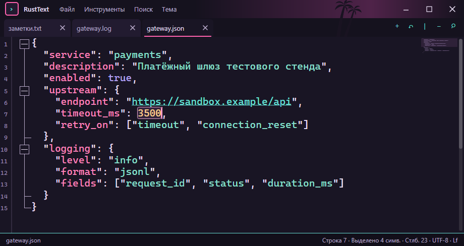
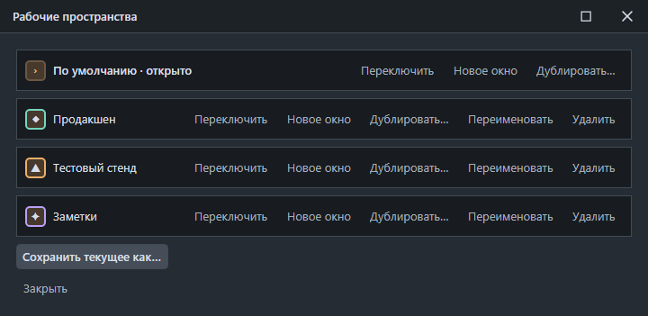
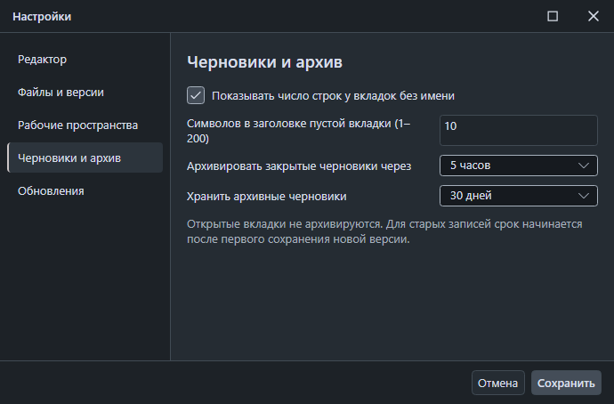
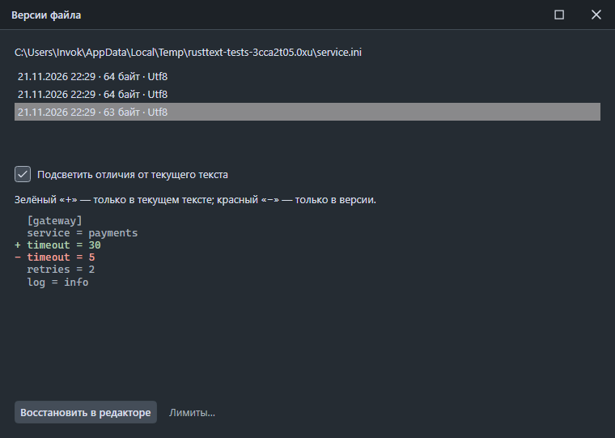
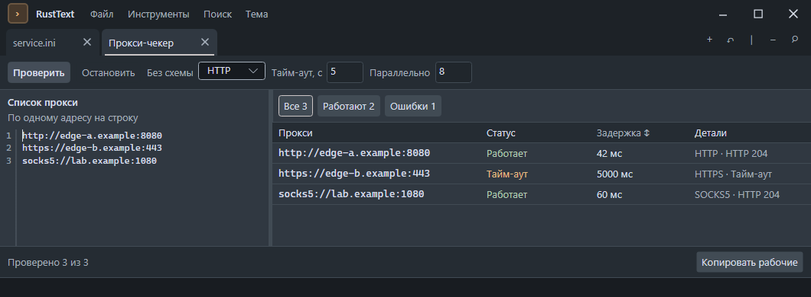

# RustText

**Текстовый редактор для Windows с рабочими пространствами, архивом черновиков и локальной историей файлов.** В том же окне — большие логи, JSON, прокси-чекер и инструменты для работы со списками.

**[Скачать для Windows x64 ↓](https://github.com/Illson/RustText/releases/latest/download/RustText.NET-win-x64.zip)** · [Что нового](https://github.com/Illson/RustText/releases/latest) · Портативный EXE

## Своя рабочая область для каждого проекта

«Продакшен», «Тестовый стенд» и «Заметки» могут быть открыты одновременно в разных окнах. У каждого пространства свои вкладки, черновики, раскладка панелей и тема. Пространство можно дублировать целиком, а удалённое — восстановить.

## Два вида истории: черновики и версии файлов

**Черновики помнят даже текст, у которого не было имени.** Закрытая заметка остаётся в «Призрачных вкладках» своего пространства, затем переходит в сжатый архив. Вы выбираете, когда архивировать черновики, сколько их хранить и нужна ли архивация вообще. Если другая программа перезаписала открытый файл, RustText оставит ваши несохранённые правки в отдельном черновике.

**Версии файлов — как локальный Git для одного файла.** RustText хранит снимки на компьютере, без репозитория и ручных коммитов. Можно сравнить снимок даже с несохранённым текстом и вернуть прежнюю версию в редактор. Файл на диске изменится только после сохранения.

## Инструменты внутри редактора

| Инструмент | Что умеет |
| --- | --- |
| **Прокси-чекер** | Параллельно проверяет HTTP, HTTPS и SOCKS5. Показывает задержку и ошибки, фильтрует результаты и копирует рабочие адреса. |
| **Сравнение списков** | Разделяет два списка на общие строки и строки, которые есть только слева или только справа. Результат можно открыть во вкладке. |
| **Генератор строк** | Создаёт данные по шаблону: порядковые номера, GUID, случайные строки. Выводит результат во вкладку или файл. |
| **Инструменты Windows** | Находят окно процесса и позволяют читать вывод уже запущенной классической консоли во вкладке с поиском. |

## Большие логи и обычный текст

- **Логи:** поиск по всему файлу, фильтры по уровням, переход по времени, слежение за новыми строками и ротацией. Открытие, постраничное чтение и переход в конец [проверены на файле 20 ГиБ](docs/verification.md).
- **Текст:** постраничная правка больших файлов, несколько курсоров, колоночное выделение, поиск и замена по регулярным выражениям.
- **JSON и JSON Lines:** подсветка, форматирование и переход к ошибке. Для JSON Lines каждая запись проверяется отдельно.

[Руководство пользователя](docs/user-guide.md) · [Выпуски](https://github.com/Illson/RustText/releases) · [Сообщить о проблеме](https://github.com/Illson/RustText/issues)
